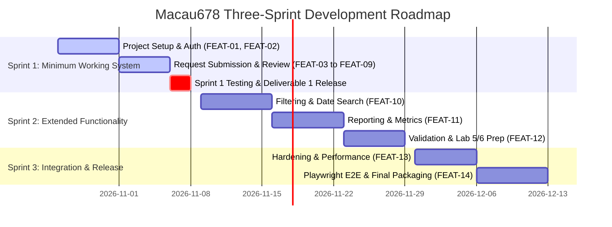

# Three-Sprint Development Plan

**Project Name:** Macau678 University Purchase Approval System  
**Course:** CPE 334 - Introduction to Software Engineering in the Age of AI Agents (Semester 1/2026)  
**Theme:** Theme 5: Workflow and Approval System  
**Traceability References:** [Software Requirements Specification (SRS)](file:///c:/Users/Cent/Desktop/Software-Engineer-2/document/srs.md) | [System Design Specification (SDS)](file:///c:/Users/Cent/Desktop/Software-Engineer-2/document/sds.md) | [Feature Inventory](file:///c:/Users/Cent/Desktop/Software-Engineer-2/document/feature.md) | [Software Test Specification](file:///c:/Users/Cent/Desktop/Software-Engineer-2/document/test.md)

---

## 1. Plan Overview and Development Strategy

The Macau678 Purchase Approval System development is planned across three sequential sprints following the **CPE 334 Three-Sprint Development Model**:

1. **Sprint 1 (Deliverable 1 - Due 8 Nov):** Deliver a working vertical slice of the core purchase approval workflow with real authentication, server-side RBAC, request creation/drafting, reviewer assignment, reviewer queue, review decision processing (approve/reject/return with reason), editing returned requests, audit history tracking, and security enforcement against self-approval and cross-user data access.
2. **Sprint 2 (Deliverable 2 - Due 29 Nov):** Expand operational workflows with multi-criteria request filtering, date range searches, aggregate status breakdown reports, financial summary metrics, enhanced form validation, and preparing containerized deployment in Lab 5.
3. **Sprint 3 (Final Project Delivery - Due 13 Dec):** Complete end-to-end system integration, hardening (security, sub-3-second performance, graceful error handling), comprehensive Playwright regression suite across desktop and tablet viewports, cross-team defect remediation (Lab 6/7), and deployment packaging.

---

## 2. Sprint 1 - Minimum Working System

### 2.1 Sprint Goal

Engineer, test, and release a fully functional, secure, end-to-end purchase approval workflow connecting a React 18 frontend, Express REST API, and PostgreSQL database. At the end of Sprint 1, a Requester can log in, draft/submit a purchase request with an assigned Reviewer, and inspect its status; an assigned Reviewer can log in, view their queue, and approve, reject, or return the request with mandatory reasons; a Requester can edit and resubmit a returned request; and all state transitions are immutably logged while strictly preventing self-approval and cross-user data access.

### 2.2 Features Included

- **`FEAT-01`**: User Authentication & Session Lifecycle
- **`FEAT-02`**: Role-Based Access Control (RBAC) & Route Authorization
- **`FEAT-03`**: Purchase Request Creation & Draft Management
- **`FEAT-04`**: Reviewer Assignment & Routing
- **`FEAT-05`**: Requester Request Tracking & Personal Dashboard
- **`FEAT-06`**: Reviewer Queue & Assignment Scope Enforcement
- **`FEAT-07`**: Review Decision Processing (Approve, Reject, Return)
- **`FEAT-08`**: Request Modification & Resubmission Workflow
- **`FEAT-09`**: Request Audit Trail & History Tracking

### 2.3 Main Implementation Tasks

1. **Infrastructure & Baseline Setup:**
   - Initialize Express backend with TypeScript, Prisma ORM, CORS, and cookie-parser.
   - Configure PostgreSQL schema in `schema.prisma` for `User`, `PurchaseRequest`, and `RequestHistory`.
   - Create idempotent seed script (`prisma/seed.ts`) with demo accounts for Requesters and Reviewers using pre-hashed bcrypt passwords.
   - Initialize Vite React SPA with Bootstrap 5.3 and typed API client (`client/src/api.ts`).
2. **Authentication & RBAC (`FEAT-01`, `FEAT-02`):**
   - Implement `POST /api/auth/login`, `POST /api/auth/logout`, and `GET /api/auth/me`.
   - Implement backend middleware `requireAuth` and `requireRole` with HTTP-only JWT cookies.
   - Implement frontend `AuthContext`, login page, and role-based navigation guards.
3. **Requester Workflows (`FEAT-03`, `FEAT-04`, `FEAT-05`, `FEAT-08`):**
   - Implement `GET /api/users/reviewers` to populate active reviewer assignment dropdown.
   - Implement `POST /api/requests` with server-side validation (title, description, amount, justification, reviewerId).
   - Implement `GET /api/requests` scoped to `currentUser.id` for Requesters.
   - Implement `PATCH /api/requests/:id` and `POST /api/requests/:id/submit` restricted strictly to `RETURNED` status.
   - Build Requester views: Dashboard, Request Creation Form, Edit Form, and Request Detail View.
4. **Reviewer Workflows & State Machine (`FEAT-06`, `FEAT-07`):**
   - Implement `GET /api/requests` scoped to assigned requests for Reviewers (`reviewerId === currentUser.id`).
   - Implement `POST /api/requests/:id/review` enforcing:
     - Non-self-approval rule (BR-03: `requesterId !== currentUser.id`).
     - Reviewer assignment rule (BR-04: `reviewerId === currentUser.id`).
     - Mandatory reason rule (BR-05: non-empty string for Reject and Return).
     - Valid lifecycle transitions (BR-07).
   - Build Reviewer views: Queue table and Review Decision Action Modal.
5. **Auditing & History (`FEAT-09`):**
   - Implement transactional creation of `RequestHistory` records for all actions (`CREATED`, `SUBMITTED`, `RESUBMITTED`, `EDITED`, `APPROVED`, `REJECTED`, `RETURNED`).
   - Implement `GET /api/requests/:id/history` and render history timeline component.

### 2.4 Expected Deliverables

- Fully runnable local full-stack application (frontend on port 5173, backend on port 3000, database in Docker).
- Version-controlled database migrations and reproducible seed script.
- Passing automated test suite with local execution results.
- Project Deliverable 1 submission package: SRS, SDS, Feature Inventory (`feature.md`), Traceability Matrix (`traceability.md`), Test Specification (`test.md`), and runnable git release commit on `main`.

### 2.5 Testing Requirements (Aligned with `test.md`)

- **Unit Tests (Vitest):**
  - Password hashing and verification using `bcrypt` (`TEST-UNIT-01`).
  - Role authorization guard logic (`TEST-UNIT-02`).
  - Status transition matrix validation (`TEST-UNIT-03`).
  - Non-self-approval and mandatory reason rules (`TEST-UNIT-04`).
- **Integration Tests (Supertest):**
  - User authentication & cookie lifecycle (`TEST-INT-01`).
  - Authentication guards & unauthenticated rejection (`TEST-INT-02`).
  - Purchase request creation & reviewer assignment (`TEST-INT-03`).
  - Requester data isolation & cross-access blocking (`TEST-INT-04`).
  - Reviewer queue scoping & assignment isolation (`TEST-INT-05`).
  - Review decision execution with business rules (`TEST-INT-06`).
  - Request modification & resubmission enforcement (`TEST-INT-07`).
  - Complete audit history persistence (`TEST-INT-08`).
- **Frontend Component Tests (React Testing Library):**
  - Login form rendering and validation (`TEST-COMP-01`).
  - Purchase request form input constraints (`TEST-COMP-02`).
  - Review decision modal reason enforcement (`TEST-COMP-03`).
  - History timeline presentation (`TEST-COMP-04`).
  - Dynamic navigation bar role rendering (`TEST-COMP-05`).
- **End-to-End (E2E) Browser Tests (Playwright):**
  - Full purchase approval journey (Draft $\rightarrow$ Submit $\rightarrow$ Return $\rightarrow$ Edit $\rightarrow$ Resubmit $\rightarrow$ Approve) (`TEST-E2E-01`).
  - Purchase rejection journey with mandatory reason (`TEST-E2E-02`).
  - Security & authorization boundary checks (`TEST-E2E-03`).

### 2.6 Dependencies

- Docker Desktop running PostgreSQL 16 container.
- Node.js v18+ LTS / v20+ LTS execution environment.

### 2.7 Definition of Done (DoD)

- [ ] All Sprint 1 features (`FEAT-01` through `FEAT-09`) are implemented and deployed locally.
- [ ] Every requirement and business rule mapped to Sprint 1 (FR-01 to FR-07, BR-01 to BR-10, AC-01 to AC-11) is verified.
- [ ] Server-side enforcement prevents invalid status transitions, self-approval, and cross-user data access.
- [ ] All Sprint 1 tests (`TEST-UNIT-01` to `TEST-UNIT-04`, `TEST-INT-01` to `TEST-INT-08`, `TEST-COMP-01` to `TEST-COMP-05`, `TEST-E2E-01` to `TEST-E2E-03`) execute and pass cleanly without mocks for persistence.
- [ ] Code is formatted, free of linting errors, reviewed via pull request, and merged into sprint staging/main.

---

## 3. Sprint 2 - Extended Functionality & Reporting

### 3.1 Sprint Goal

Expand the operational utility of the system by implementing multi-criteria filtering, submission date range queries, status aggregation reporting, financial metrics calculations, enhanced form validation, and preparing the codebase for containerized deployment in Lab 5.

### 3.2 Features Included

- **`FEAT-10`**: Multi-Criteria Request Filtering & Search
- **`FEAT-11`**: Status Breakdown & Financial Metrics Reporting
- **`FEAT-12`**: Enhanced Form Validation & Numeric Boundary Checking

### 3.3 Main Implementation Tasks

1. **Dynamic Filtering & Search (`FEAT-10`):**
   - Update `GET /api/requests` endpoint to accept query parameters: `status`, `startDate`, `endDate`, and `search`.
   - Implement Prisma dynamic `where` clause filters with date range comparisons (`gte`, `lte`).
   - Add interactive filter controls in both Requester Dashboard and Reviewer Queue with clear filter reset triggers.
2. **Reporting & Aggregations (`FEAT-11`):**
   - Implement `GET /api/reports/summary` returning total requests, count by status, and total amount requested.
   - Implement `GET /api/reports/requests` returning filtered requests with summary metrics.
   - Build `RequestReports.tsx` dashboard view with visual status breakdown bars and financial totals.
3. **Validation & Boundaries (`FEAT-12`):**
   - Enforce currency bounds and precision (`Decimal(12, 2)` positive checks) on backend and frontend inputs.
   - Add dynamic character counters and boundary indicators for title (3–150), description (max 2000), and justification (max 2000).
   - Implement field-level error messages directly under form controls.
4. **Lab 5 Preparation & Cross-Sprint Continuity:**
   - Verify Dockerfile multi-stage builds and compose configurations for CI/CD containerization.
   - Maintain regression baseline ensuring Sprint 1 approval workflows remain unbroken.

### 3.4 Expected Deliverables

- Working `/reports` view with aggregated metrics and dynamic filters.
- Enhanced form interfaces with real-time validation and character limits.
- Updated test suite covering reporting queries, filter combinations, and boundary values.
- Project Deliverable 2 submission package: updated traceability, increment release commit, and demonstrated progress.

### 3.5 Testing Requirements (Aligned with `test.md`)

- **Unit Tests (Vitest):**
  - Input validation & boundary checks (`TEST-UNIT-05`).
  - Financial aggregation & status metrics math (`TEST-UNIT-06`).
- **Integration Tests (Supertest):**
  - Request filtering by status and date range (`TEST-INT-09`).
  - Reporting summary aggregation endpoint (`TEST-INT-10`).
- **End-to-End (E2E) Browser Tests (Playwright):**
  - Multi-criteria filter & reports journey (`TEST-E2E-04`).

### 3.6 Dependencies

- Stable Sprint 1 core approval workflow and database schema.

### 3.7 Definition of Done (DoD)

- [ ] All Sprint 2 features (`FEAT-10`, `FEAT-11`, `FEAT-12`) are fully implemented and integrated.
- [ ] Requirements FR-08 and AC-12 are completely verified by automated tests (`TEST-UNIT-05`, `TEST-UNIT-06`, `TEST-INT-09`, `TEST-INT-10`, `TEST-E2E-04`).
- [ ] Existing Sprint 1 functionality passes regression checks without failure.
- [ ] Filter queries and reports handle empty result sets gracefully with informative empty-state UI.
- [ ] PR reviewed, automated tests pass in CI/local runner, and merged into main branch.

---

## 4. Sprint 3 - Integration, Hardening & Final Release

### 4.1 Sprint Goal

Execute comprehensive non-functional hardening (security audits, sub-3-second response latency tuning, robust error boundaries), complete full-journey regression test automation via Playwright across multiple viewports, remediate cross-team UAT defects (Lab 6/7), finalize project documentation, and prepare the production release container for Google Cloud Platform (GCP).

### 4.2 Features Included

- **`FEAT-13`**: System Performance & Security Hardening
- **`FEAT-14`**: End-to-End System Verification & Release Packaging

### 4.3 Main Implementation Tasks

1. **Security & Non-Functional Hardening (`FEAT-13`):**
   - Conduct security audit: verify cookie security attributes (`HttpOnly`, `SameSite=Lax`, `Secure` in production).
   - Implement rate limiting and security headers (Helmet) on Express API.
   - Add database query performance indexes on `[status]`, `[requesterId]`, `[reviewerId]`, `[createdAt]`.
   - Benchmark response latencies to guarantee normal user operations complete under 3 seconds (NFR-03).
   - Refine global error handler to prevent stack trace leakage while providing actionable messages (NFR-02).
2. **Comprehensive Playwright E2E Suite (`FEAT-14`):**
   - Implement automated end-to-end regression journeys simulating complete user workflows.
   - Configure Playwright test profiles for Desktop (1280x720) and Tablet (768x1024) viewports.
   - Automate negative security test cases: unauthorized route access, token tampering, and self-approval attempts.
3. **UAT Defect Remediation & Maintenance (Lab 6 & 7):**
   - Triage, fix, and verify defects identified during partner UAT testing.
   - Apply controlled maintenance change and verify regression test safety per Lab 7.
4. **Final Release Packaging:**
   - Package final Docker production container with multi-stage build.
   - Verify deployment configurations for GCP Cloud Run / Cloud SQL.
   - Prepare demonstration script, video walkthrough, and final project report.

### 4.4 Expected Deliverables

- Production-ready Docker container deployable to GCP.
- Comprehensive, 100% passing automated test suite (Unit, Integration, Playwright E2E).
- Complete Requirements Traceability Matrix (`traceability.md`) demonstrating 100% coverage of FRs, BRs, NFRs, and ACs.
- Final Delivery package: demonstration video (max 10 minutes), final release report, repository tag, and deployed application URL.

### 4.5 Testing Requirements (Aligned with `test.md`)

- **Regression Testing:** Automated execution of all unit and integration tests from Sprints 1, 2, and 3 (`TEST-UNIT-01` to `TEST-UNIT-06`, `TEST-INT-01` to `TEST-INT-10`, `TEST-COMP-01` to `TEST-COMP-05`).
- **Playwright E2E Testing:**
  - Complete full lifecycle test: Requester Draft $\rightarrow$ Submit $\rightarrow$ Reviewer Return $\rightarrow$ Requester Edit $\rightarrow$ Resubmit $\rightarrow$ Reviewer Approve (`TEST-E2E-01`).
  - Cross-viewport responsive design verification on Desktop (1280x720) and Tablet (768x1024) (`TEST-E2E-05`).
  - Parallel negative test cases: direct URL navigation to protected views without auth, attempt to approve own request, attempt to review unassigned request (`TEST-E2E-03`).
- **Performance Benchmark Testing:** Automated timing assertions verifying API response times remain well within the 3.0-second threshold under normal loads (NFR-03).
- **Security & Vulnerability Scans:** Automated checks for dependency vulnerabilities (`npm audit`) and input sanitization (NFR-01).

### 4.6 Dependencies

- Completed and verified Sprint 1 and Sprint 2 feature increments.
- Feedback and findings from Lab 6 UAT testing.

### 4.7 Definition of Done (DoD)

- [ ] All features (`FEAT-01` through `FEAT-14`) are implemented, integrated, and verified.
- [ ] 100% of functional requirements (FR-01 to FR-08), business rules (BR-01 to BR-10), non-functional requirements (NFR-01 to NFR-05), and acceptance criteria (AC-01 to AC-12) are verified with passing automated test evidence.
- [ ] Zero known critical or high-severity defects.
- [ ] Multi-viewport Playwright E2E tests pass reliably in headless test runs.
- [ ] Application is successfully containerized, deployed, and verified in cloud environment.
- [ ] Final release tagged on `main` branch with reproducible setup instructions.

---

## 5. Sprint-to-Feature Summary Matrix

|    Sprint    | Deliverable & Due Date              | Feature IDs Included                                                                              | Scope Focus                                                                                     | Primary Verification Level & Test IDs                                                                                    |
| :----------: | :---------------------------------- | :------------------------------------------------------------------------------------------------ | :---------------------------------------------------------------------------------------------- | :----------------------------------------------------------------------------------------------------------------------- |
| **Sprint 1** | Deliverable 1 (Due 8 Nov 2026)   | `FEAT-01`, `FEAT-02`, `FEAT-03`, `FEAT-04`, `FEAT-05`, `FEAT-06`, `FEAT-07`, `FEAT-08`, `FEAT-09` | Minimum Working System: Full approval vertical slice, auth, RBAC, history, transition integrity | Vitest (`TEST-UNIT-01`–`04`), Supertest (`TEST-INT-01`–`08`), RTL (`TEST-COMP-01`–`05`), Playwright (`TEST-E2E-01`–`03`) |
| **Sprint 2** | Deliverable 2 (Due 29 Nov 2026)  | `FEAT-10`, `FEAT-11`, `FEAT-12`                                                                   | Extended Functionality: Filtering, date search, status/financial reports, boundary validation   | Vitest (`TEST-UNIT-05`–`06`), Supertest (`TEST-INT-09`–`10`), Playwright (`TEST-E2E-04`)                                 |
| **Sprint 3** | Final Delivery (Due 13 Dec 2026) | `FEAT-13`, `FEAT-14`                                                                              | Hardening & Release: Performance, security, multi-viewport Playwright regression, packaging     | Full Playwright E2E regression suite (`TEST-E2E-01`–`05`) + Security/perf tests                                          |
